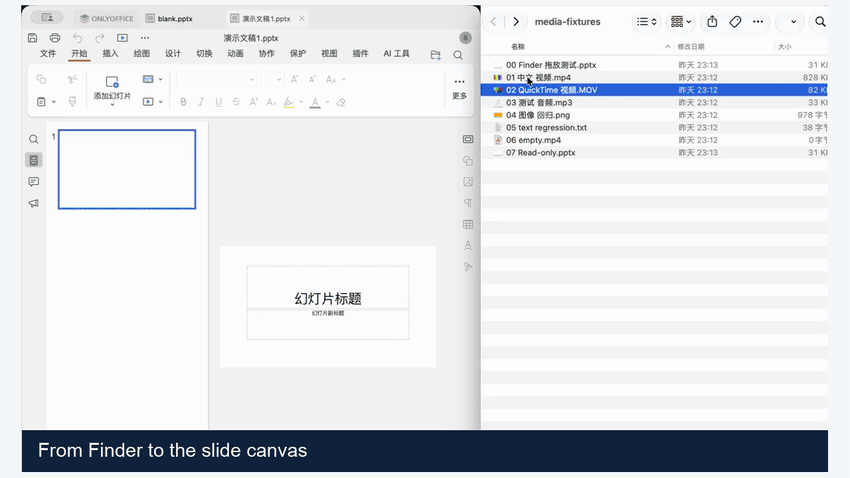

# ONLYOFFICE Media Drop for macOS

从 Finder 把本地 **MP4、MOV 和 MP3** 直接拖进 ONLYOFFICE Desktop Editors 的幻灯片画布。给 Mac 上的 PPT 插入本地视频或音频，保存为内嵌媒体的 **PPTX**，随演示文稿离线播放。

Drag and drop local video and audio from **Finder** into slides in **ONLYOFFICE Desktop Editors** on macOS. Embed MP4, MOV, and MP3 in a PowerPoint PPTX file for offline playback.

## 演示 · Demo

https://github.com/user-attachments/assets/78af933d-40a9-407d-888e-da8e1acc3ecc

演示录制自 Mac 上的 Finder 和实验版编辑器。片尾展示了从重开的 PPTX 中读出的内嵌视频。 [下载 MP4](https://github.com/shaochang123/onlyoffice-media-drop/releases/download/v0.1.0/onlyoffice-media-drop-demo.mp4)

<details>
<summary>查看动图预览</summary>



</details>

## 兼容性

| 项目 | v0.1.0 支持范围 |
| --- | --- |
| Mac | Apple Silicon（arm64） |
| 编辑器 | ONLYOFFICE Desktop Editors 10.0.0（564），演示 SDK 10.0.0（169） |
| 演示文件 | 本地 `.pptx`，普通幻灯片编辑视图 |
| 视频 | MP4、QuickTime MOV，实测 H.264 视频与 AAC 音轨 |
| 音频 | MP3 |
| 构建环境 | Node.js 22 或更新版本 |

## 安装

下载并解压预发布版的源码 ZIP。在解压后的项目目录执行构建命令。 [下载 v0.1.0](https://github.com/shaochang123/onlyoffice-media-drop/releases/tag/v0.1.0)

```bash
mkdir -p "$HOME/Applications"
./scripts/build-macos.sh --output "$HOME/Applications/Media Drop for ONLYOFFICE.app"
```

构建脚本默认从 `/Applications/ONLYOFFICE.app` 读取应用。安装在其他位置时，用 `--source` 指定路径。生成的 **Media Drop for ONLYOFFICE.app** 有独立应用标识和配置目录。也可以将 `--output` 指向 `.app.zip`，把可解压的 App 存在同步目录。

## 拖放音视频

1. 启动 **Media Drop for ONLYOFFICE**，打开或新建本地 PPTX。
2. 在普通编辑视图选中一页，把 Finder 中的 MP4、MOV 或 MP3 拖到幻灯片画布。多选的媒体会按 Finder 提供的顺序插入。
3. 保存 PPTX。放映时点击媒体对象播放视频或音频。

## 常见问题

**如何在 Mac 上给 PPT 插入本地视频？** 在实验版里打开本地 PPTX，把 Finder 里的 MP4 或 MOV 拖到当前幻灯片。媒体对象沿用编辑器的原生插入位置，可在画布上移动和调整大小。

**PPTX 内嵌音视频后能离线播放吗？** 保存后的媒体文件和引用都在 PPTX 包内。把 PPTX 带到另一台机器上，使用支持对应编码的演示软件即可播放。

**为什么当前页面接收不了 Finder 拖放？** 在 **Media Drop for ONLYOFFICE** 中打开本地 PPTX，切到普通幻灯片编辑视图，从 Finder 拖到正在编辑的画布。拖放遵循编辑器当前的编辑权限。以文件权限只读方式打开的文稿，ONLYOFFICE 允许编辑副本，保存时需要新名称或新位置。

**同步目录保存报错怎么办？** 先另存到本机未同步的文件夹，再重新打开该 PPTX 验证。同步目录中的桌面版保存问题已有上游记录。 [ONLYOFFICE Desktop Editors #2547](https://github.com/ONLYOFFICE/DesktopEditors/issues/2547)

## Install and use

Use an **Apple Silicon Mac**, **ONLYOFFICE Desktop Editors 10.0.0 build 564**, and **Node.js 22+**. Extract the source archive and run the build command above. Launch **Media Drop for ONLYOFFICE**, open a local PPTX, and drop local videos or audio onto the current slide. Save the presentation to keep the embedded media. [Release and downloads](https://github.com/shaochang123/onlyoffice-media-drop/releases)

## 开发与验证 · Testing

```bash
node --test test/media-drop.test.mjs
python3 test/verify-pptx-media.py demo.pptx --expect '1=video.mp4' --expect '2=audio.mp3'
```

The PPTX verifier follows each slide’s internal media relationships and compares the embedded payload against the source file’s SHA-256. See the SDK version and desktop drag-and-drop issue for implementation context. [ONLYOFFICE SDK 10.0.0.169](https://github.com/ONLYOFFICE/sdkjs/tree/v10.0.0.169) · [Desktop Editors issue #2544](https://github.com/ONLYOFFICE/DesktopEditors/issues/2544)

实机验证覆盖了 Finder 逐个与批量拖放、新建和已有 PPTX、撤销与重做，以及移走原媒体后重新打开的放映播放。 [验证记录](docs/validation.md)

AGPL-3.0. ONLYOFFICE is a trademark of Ascensio System SIA. [License](LICENSE)

如果这个扩展帮你省下了给 PPT 插入音视频的时间，欢迎点个 **Star**。
